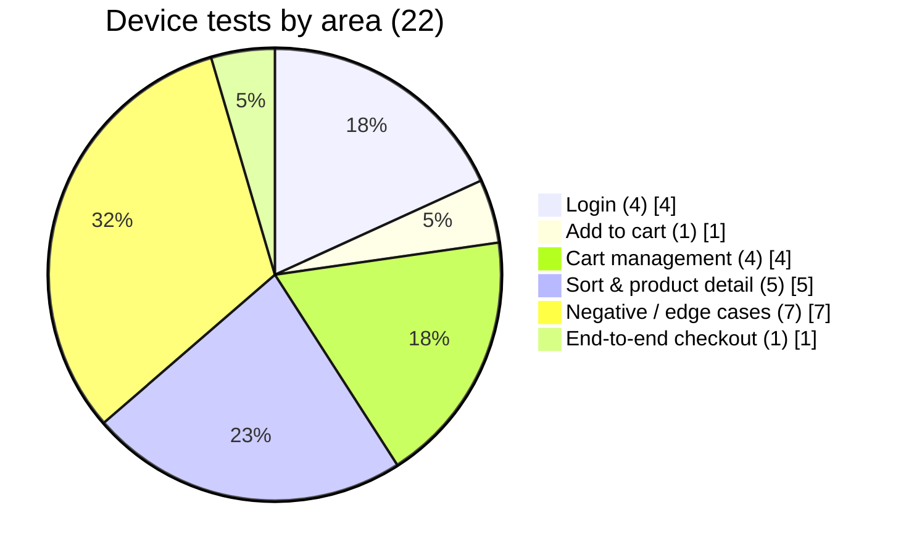
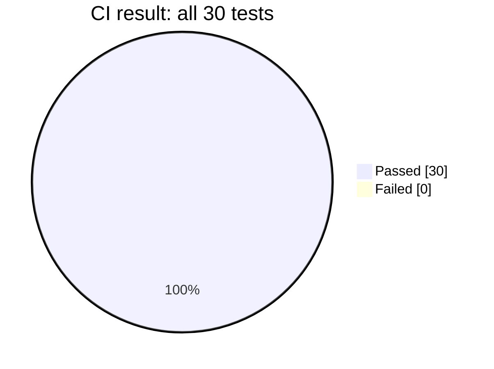
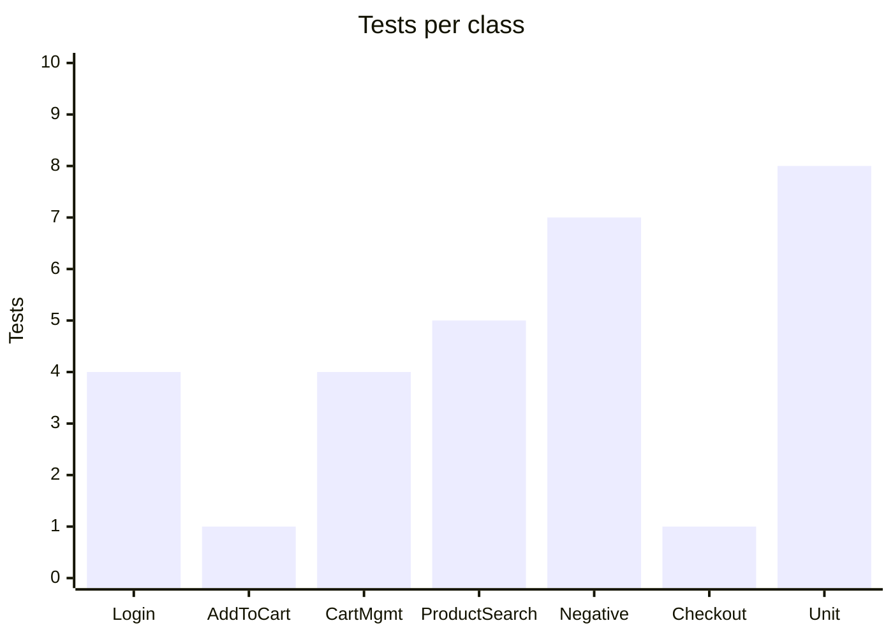
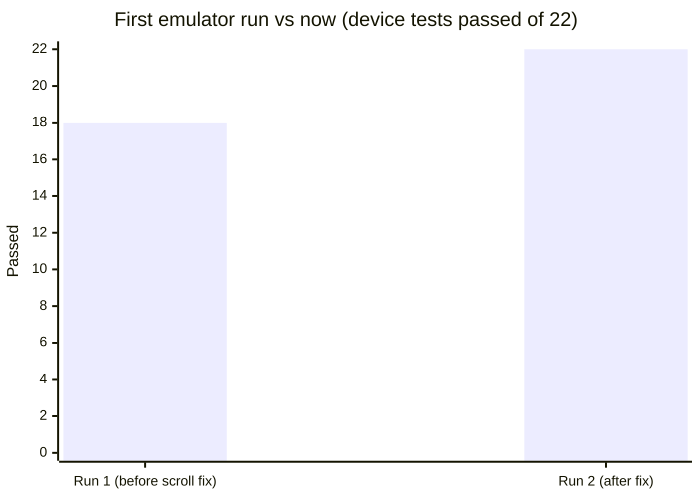
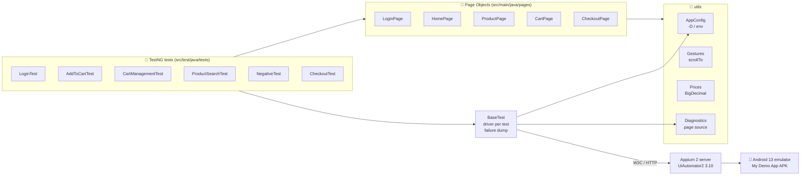
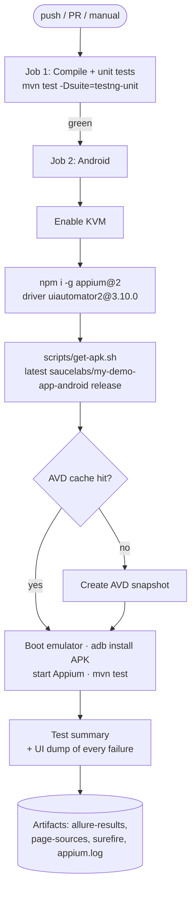
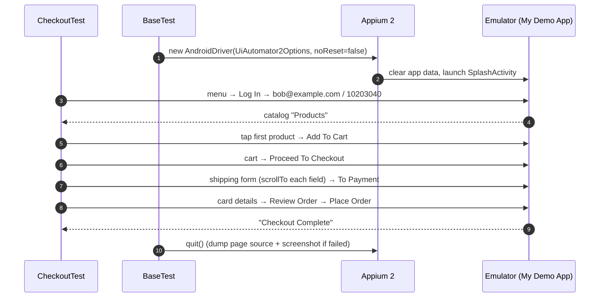
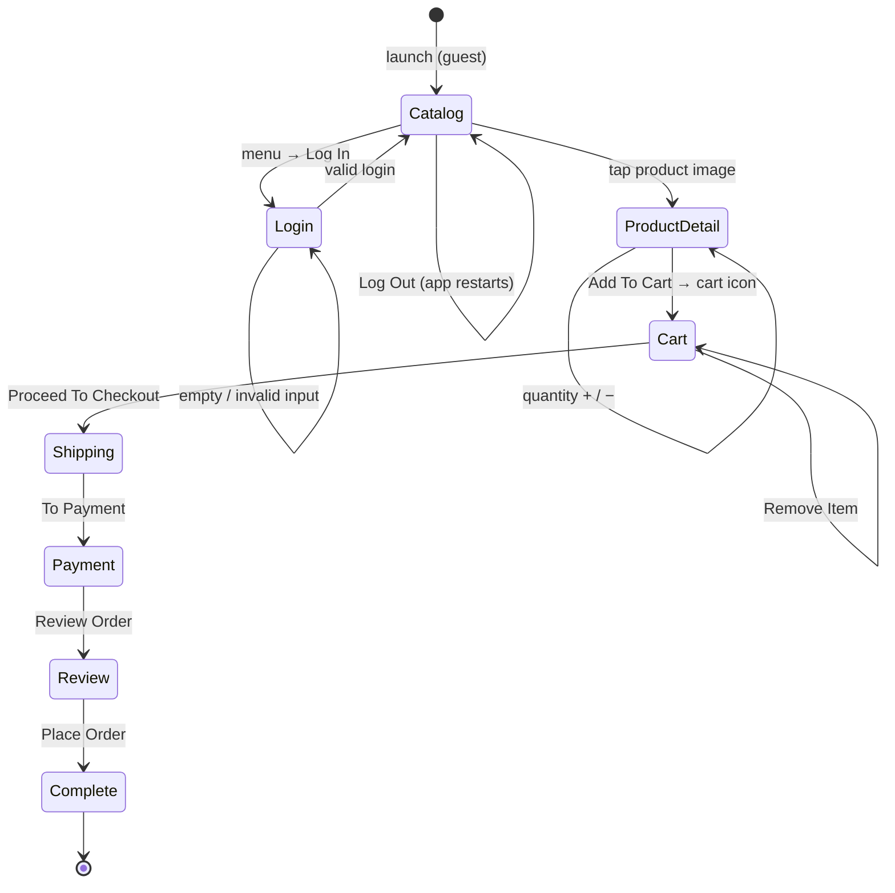
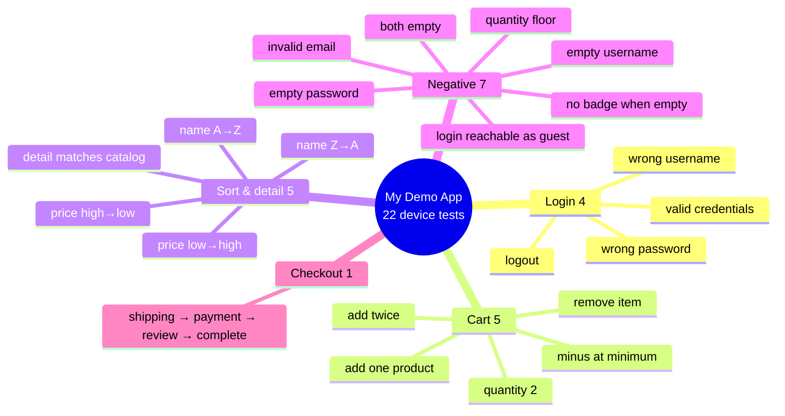
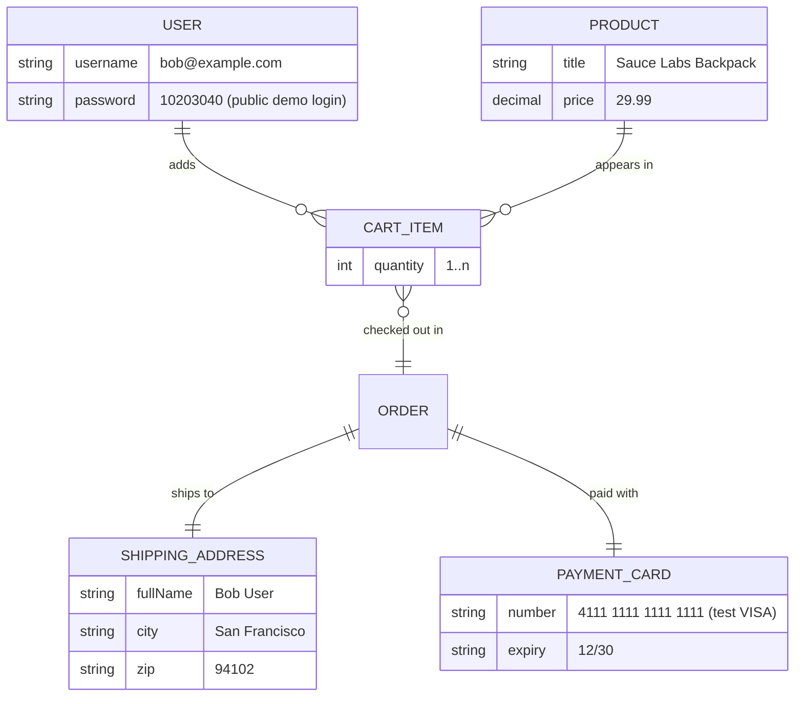

<div align="center">

# 📱 Appium Mobile Automation — Sauce Labs My Demo App (Java · Appium · TestNG)

### Android end-to-end tests for Sauce Labs' *My Demo App*: login, catalog sorting, cart, a full checkout, and negative cases. Page Objects, Appium 2 + UiAutomator2, Allure, and a real Android 13 emulator in GitHub Actions.

[](https://git.io/typing-svg)

<!-- ============ STATUS BAR ============ -->
[](https://github.com/rbchy/AppiumMobileAutomation/actions/workflows/ci.yml)


</div>

---

## 📌 At a Glance

<table>
<tr>
<td width="50%" valign="top">

**🙋 What this is**

A Page Object framework that tests the Android build of **[Sauce Labs My Demo App](https://github.com/saucelabs/my-demo-app-android)** (`com.saucelabs.mydemoapp.android`), the native shopping app Sauce Labs publishes for automation practice. It covers:

- login, logout and invalid / empty credentials
- catalog sorting by name and price (A→Z, Z→A, low→high, high→low)
- product detail, quantity +/− and the cart badge
- removing items and an **end-to-end checkout** (shipping → payment → review → *Checkout Complete*)

Every push runs it. GitHub Actions boots an **Android 13 emulator** (KVM), starts **Appium 2 + UiAutomator2**, downloads the latest My Demo App APK, installs it, and runs the full regression suite. Allure results, failure screenshots, UI-hierarchy dumps and the Appium log are uploaded as artifacts.

</td>
<td width="50%" valign="top">

**📍 Quick facts**

| | |
|---|---|
| 🤖 **App** | Sauce Labs My Demo App 2.3.0 (native Android) |
| 📱 **Device** | Android 13 emulator (API 33, x86_64) |
| 🧪 **Device tests** | 22 in 6 classes |
| 🧩 **Unit tests** | 8 (no device; price parsing, config, diagnostics) |
| ✅ **CI** | 22 / 22 + 8 / 8 · suite ≈ 8 min |
| 🧱 **Pattern** | Page Object Model, one fresh driver per test |
| 📊 **Reports** | Allure · screenshot + UI XML on failure |
| 🔁 **Runs** | push · pull request · manual |

</td>
</tr>
</table>

---

## ✅ Latest Results (GitHub Actions, Android 13 emulator)

| Suite | Tests | ✅ Passed | ❌ Failed | Where it runs |
|---|---:|---:|---:|---|
| 🧩 Unit (`testng-unit.xml`) | 8 | 8 | 0 | plain JVM, ~1 s |
| 📱 Regression (`testng.xml`) | 22 | 22 | 0 | Android 13 emulator, ~8 min |
| **Total** | **30** | **30** | **0** | |









> Run 1 failed 4 tests on the CI emulator's smaller screen: the quantity +/− buttons and the lower checkout fields were below the fold. `utils.Gestures.scrollTo` fixed all four.

---

## 🏗️ Architecture



### CI pipeline



### One test, end to end



### App screens the suite walks through



---

## 🧪 Test Cases



| Class | # | What it checks | Reset |
|---|---:|---|---|
| `LoginTest` | 4 | valid login reaches the catalog; wrong password / username leave the app on login or catalog (the demo app uses mock auth); logout returns to guest | full |
| `AddToCartTest` | 1 | badge count goes from *n* to *n + 1* | keeps state |
| `CartManagementTest` | 4 | quantity 2 → badge 2; minus at 1 never goes negative; two adds → 2; remove the only item → empty cart | full |
| `ProductSearchTest` | 5 | four sort orders verified on the visible list (prices compared as `BigDecimal`); detail title equals catalog title | keeps state |
| `NegativeTest` | 7 | empty / both-empty / malformed credentials; quantity floor; no "0" badge on an empty cart; login form reachable as guest | full |
| `CheckoutTest` | 1 | full purchase ends on *Checkout Complete* | full |
| `unit.UtilsTest` | 8 | price parsing (`$ 1,049.00`, rejects `$ .`), numeric not alphabetical ordering, portable dump folder, `-D` overrides | no device |

### Data the tests use



> `bob@example.com / 10203040` is the **public demo login printed in the app itself**, not a real account.

---

## ▶️ Running Locally

**Prerequisites:** JDK 17, Maven 3.9+, Node 20, Android SDK with an emulator (or a device), Appium 2.

```bash
# 1. Appium 2 + the UiAutomator2 driver line that supports Appium 2
npm install -g appium@2
appium driver install uiautomator2@3.10.0
appium &                                   # listens on http://127.0.0.1:4723

# 2. Start an emulator, then get the app (or install it yourself from the Sauce Labs releases)
GH_TOKEN=<token> ./scripts/get-apk.sh      # downloads mda-*.apk next to pom.xml
adb install -r mda-*.apk

# 3. Run
mvn test                                   # full regression (testng.xml)
mvn test -Dsuite=testng-smoke              # AddToCartTest only
mvn test -Dsuite=testng-unit               # 8 device-free unit tests
mvn allure:serve                           # open the Allure report
```

| Setting | `-D` property | Env var | Default |
|---|---|---|---|
| Appium server | `appium.url` | `APPIUM_URL` | `http://127.0.0.1:4723` |
| Device | `device.name` | `DEVICE_NAME` | `emulator-5554` |
| APK to install | `app.path` | `APP_PATH` | *(empty: use the installed app)* |
| Dump folder | `page.source.dir` | | `target/page-sources` |

---

## 📁 Project Structure

```text
AppiumMobileAutomation/
├── .github/workflows/ci.yml       # unit job + Android 13 emulator job
├── scripts/get-apk.sh             # downloads the latest My Demo App APK
├── pom.xml                        # java-client 9.2.2 · TestNG 7.10.2 · surefire 3.2.5 · Allure
├── src/main/java/
│   ├── pages/                     # LoginPage · HomePage · ProductPage · CartPage · CheckoutPage
│   └── utils/                     # AppConfig · Gestures · Prices · Diagnostics
└── src/test/
    ├── java/base/BaseTest.java    # driver per test, failure screenshot + page source
    ├── java/tests/                # 6 device test classes (22 tests)
    ├── java/unit/UtilsTest.java   # 8 unit tests
    └── resources/                 # testng.xml · testng-smoke.xml · testng-unit.xml
```

---

## 🧹 Maintenance Log

| Area | Before | Now |
|---|---|---|
| Suite wiring | surefire 2.22 with **no `suiteXmlFiles`** → only the `assertTrue(true)` SmokeTest ran | surefire 3.2.5 runs `src/test/resources/${suite}.xml` (default: full regression) |
| TestNG | 7.4.0 (inherited `@BeforeMethod` bug) | 7.10.2 |
| Diagnostics | page sources written to a hard-coded `/Users/…/eclipse-workspace/…` path | `target/page-sources/`; screenshot + UI XML saved for every failed test |
| Capabilities | URL, device and app hard-coded | `-D` / env overrides; CI installs the APK via `APP_PATH` |
| Small screens | `findElement` on +/−, zip, country and buttons failed below the fold | `Gestures.scrollTo` swipes until visible |
| Prices | `Double.parseDouble` after stripping `$` | `utils.Prices` (`BigDecimal`, handles `1,049.00`, rejects junk) |
| Test card | expiry `12/25` (already in the past) | `12/30` |
| Repo hygiene | `test-output/`, 9 debug XML dumps and logs committed | removed; `.gitignore` added |
| README | listed test classes that don't exist, claimed "23/23" and saucedemo.com as the app | rewritten from the code and the CI run |
| CI | none | GitHub Actions: unit job + Android 13 emulator job |

---

## 📈 Roadmap

- [x] Android emulator CI on every push
- [x] Failure screenshots + UI-hierarchy dumps as artifacts
- [ ] Publish the Allure report to GitHub Pages
- [ ] iOS run of the same flows (My Demo App iOS build)
- [ ] Data-driven login cases from a CSV / `@DataProvider`
- [ ] Run on a cloud device grid (Sauce Labs / BrowserStack) via `APPIUM_URL`

---

## 🔗 Related Projects

| Repo | What it is |
|---|---|
| [WebdriverIO-Native-DemoApp-MobileTestAutomationJavaAppiumTestNG](https://github.com/rbchy/WebdriverIO-Native-DemoApp-MobileTestAutomationJavaAppiumTestNG) | Appium + TestNG on WebdriverIO's React Native demo app, same emulator CI |
| [NorthFace_AutomationExercise-BDD-Test-Automation](https://github.com/rbchy/NorthFace_AutomationExercise-BDD-Test-Automation) | Selenium + Cucumber BDD web suite |
| [Guru99TelTest](https://github.com/rbchy/Guru99TelTest) | Selenium + TestNG web tests |
| [AmazonSeleniumTest](https://github.com/rbchy/AmazonSeleniumTest) | Selenium web tests with bot-wall detection |
| [rbchy](https://github.com/rbchy/rbchy) | Profile and full project list |

---

## ⚠️ Disclaimer

Educational / portfolio project. *My Demo App* is published by Sauce Labs for test-automation practice; this repo is not affiliated with Sauce Labs. The login and the card number are public demo values.

---

## 👤 Author

<div align="center">

**Ranajit Baran Chowdhury (RB Chowdhury)**
QA Automation Engineer / SDET · West Norriton, Pennsylvania, USA

[](https://www.linkedin.com/in/rbchy/)
[](https://github.com/rbchy)
[](https://rbchy.github.io/rbchy/)
[](https://rbc6543.wixsite.com/rbc-portfolio)
[](mailto:chyranajit@gmail.com)

⭐ *If this project helps you, a star on the repo is appreciated.*

</div>
